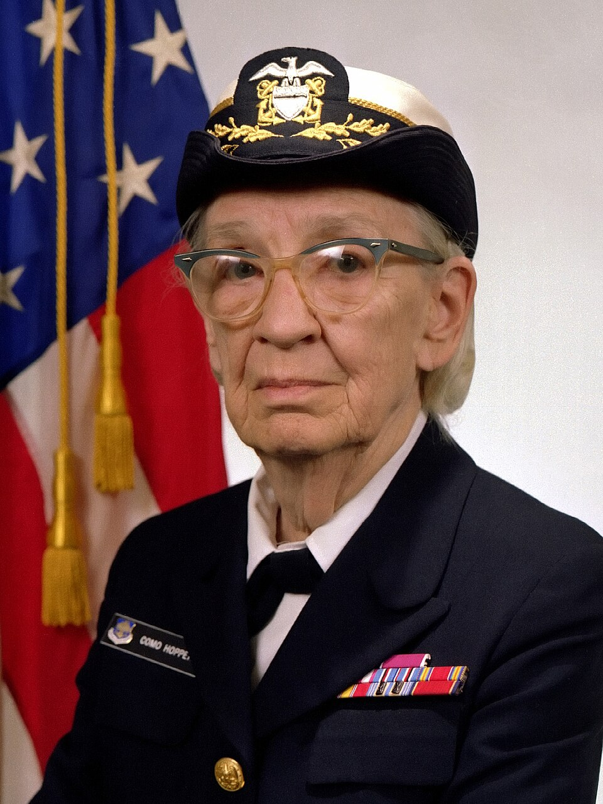
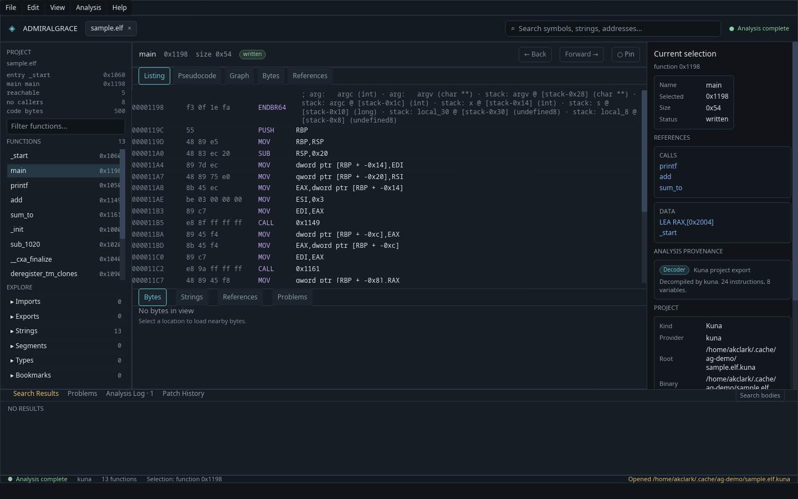
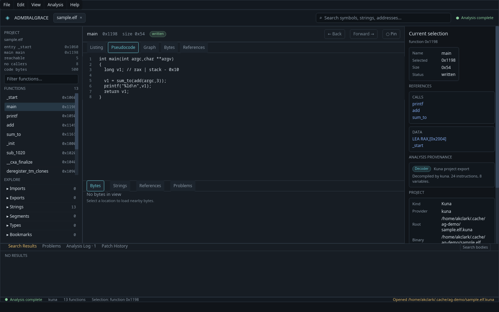
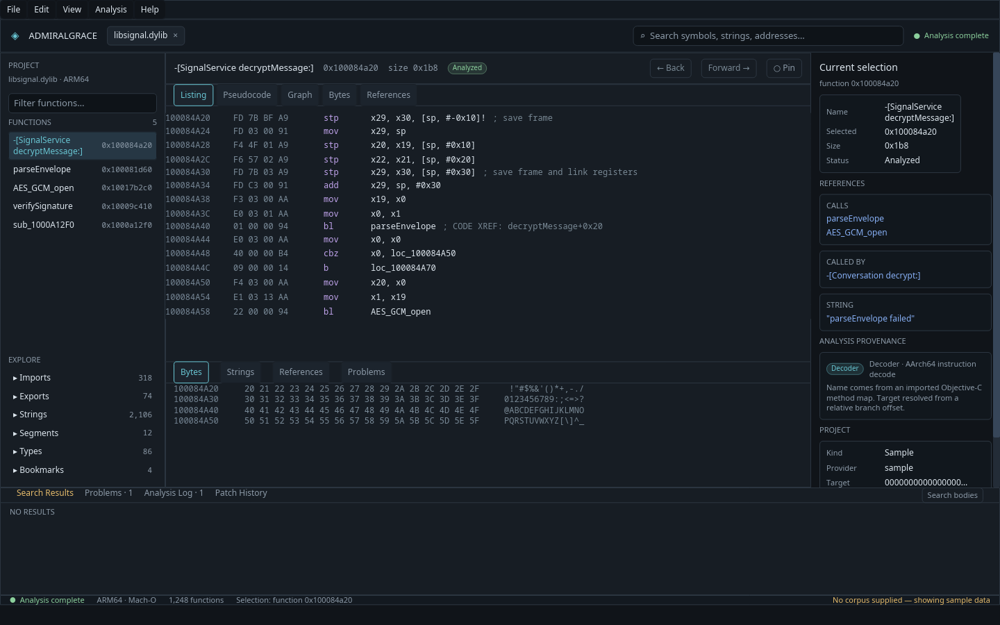
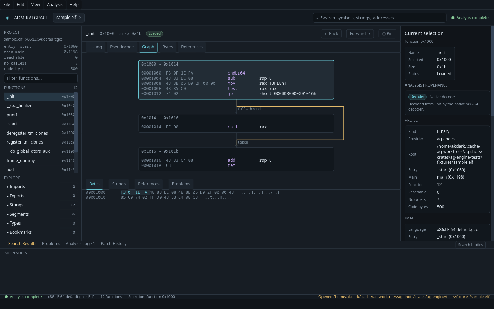
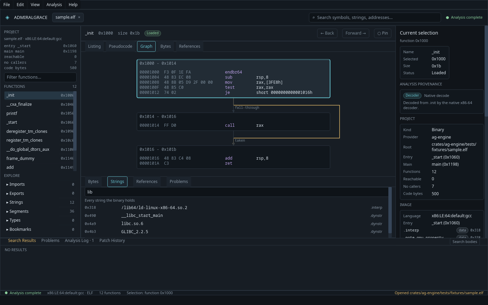

# AdmiralGrace

> **Part of the [Reverse Engineering Armada](https://github.com/CryptoJones/RE-Armada):** [GayHydra](https://github.com/CryptoJones/GayHydra) — security-hardened Ghidra fork · [Scylla](https://github.com/CryptoJones/Scylla) — RE platform with a Rust core over GayHydra's engine · **AdmiralGrace** (this repo) — disassembler and decompiler written in Rust



AdmiralGrace is an open-source disassembler and decompiler utility written in Rust. It is named in honor of Admiral Grace Hopper, a pioneer of computer programming and compiler development.

The project is in an early, actively developing stage. The workspace holds a desktop analysis workbench, a command-line tool that reads decompilation output, and the beginnings of a native disassembly and decompilation engine. Today the workbench and the CLI read two kinds of analysis: an indexed decompilation corpus, and a project export from the [kuna](https://github.com/Noelo-Lab/kuna) decompiler. The native binary-to-pseudocode pipeline has its first slices: a function of x86-64 code — its calls, branches and loops — is lifted and printed as C, with `if`/`else`, `while`, `for` and early `return`.

## Screenshots

The workbench on a kuna project export of a small ELF. The listing comes from the export's `.asm`, the cross references, strings and program summary from the kuna CLI, and the selection is shared by every pane.



The same function on the Pseudocode tab. Lines that kuna mapped to addresses are numbered and clickable, so a click on a line moves the listing to the instructions it came from.



The bundled sample project, which opens when no corpus or export is given, so the interface can be explored without a binary.



The native path: an ELF read by the engine's own loader, with no corpus and no export. The Graph tab draws the control-flow graph of the selected function, and the Bytes panel below holds the bytes of the file around the selection.



The Strings tab lists the text the image holds, with the functions that use it, and filters the list as you type.



## Workspace

- `ag-corpus` reads an indexed decompilation corpus and a kuna project export, and overlays Objective-C method names.
- `ag-cli` builds the `ag` command-line tool: it reports on either source and carries its own manual and an agent skill.
- `ag-engine` holds the program image loader (ELF, PE, COFF and Mach-O, through the kuna-analysis crate), the native x86 decoder (32-bit and 64-bit, the width read from the image's language), the control-flow graph builder, the first slices of the lifter (x86-64 code with calls, branches and loops, to the AST, structured with dominators and back edges), and the C emitter.
- `ag-image` reads a program image through the engine: its sections, its symbols, the bytes of the file, the disassembly of a function, its pseudocode, the calls between the functions, and the strings of the data sections.
- `ag-ui` builds the `ag-ui` desktop analysis workbench, an [Iced](https://iced.rs) application that reads both sources through the same data layer the CLI uses and asks the kuna CLI for what an export does not carry.

## Build

Install the [Rust toolchain](https://www.rust-lang.org/tools/install), then build from the repository root:

```sh
cargo build
```

Run the CLI with Cargo:

```sh
cargo run --bin ag -- --help
```

## Corpus CLI

The current CLI reads a corpus directory containing `decompile-index.json` and the function files referenced by that index. Pass `--root` to select the corpus directory.

```sh
# Summarize the corpus
cargo run --bin ag -- corpus --root ./corpus stats

# List functions, optionally filtering names with a regular expression
cargo run --bin ag -- corpus --root ./corpus list --named-only --filter 'decrypt|parse'

# Show a function by address or name
cargo run --bin ag -- corpus --root ./corpus show 0x1000

# Search function bodies with a regular expression
cargo run --bin ag -- corpus --root ./corpus grep 'memcpy|malloc'
```

Objective-C method names can be overlaid from a method map with `--methods PATH`. See `cargo run --bin ag -- corpus --help` and `cargo run --bin ag -- corpus --root ./corpus list --help` for all options.

## Image CLI

The CLI reads a program image as well: an ELF, PE, COFF or Mach-O file, parsed by the engine's own loader.

```sh
# The language, the entry point and the sections
cargo run --bin ag -- image ./sample.elf info

# The function and data symbols
cargo run --bin ag -- image ./sample.elf symbols --filter 'main|add'

# The disassembly of one function, by name or by address
cargo run --bin ag -- image ./sample.elf disasm main

# The pseudocode of one function, as C
cargo run --bin ag -- image ./sample.elf pseudocode main

# The control-flow graph of one function
cargo run --bin ag -- image ./sample.elf cfg main

# Who calls whom
cargo run --bin ag -- image ./sample.elf calls

# The strings of the image, and the functions that use them
cargo run --bin ag -- image ./sample.elf strings

# The data of the image, and the functions that use it
cargo run --bin ag -- image ./sample.elf data

# All of the above, written as a directory of JSON and text
cargo run --bin ag -- image ./sample.elf export ./sample.ag
```

Every subcommand takes `--json` for the same report as JSON. `info` and `symbols` read any format the loader reads; `disasm` decodes x86, 32-bit and 64-bit, taking the width from the image's language (`x86:LE:32:...` or `x86:LE:64:...`), so it refuses an image of another architecture rather than printing nonsense.

`strings` reads the sections that are not code and reports the text that ends in a NUL, with the functions that use it. `--filter` keeps only the strings whose text matches a regular expression, and `--utf16` reports the strings that are held as UTF-16LE.

`pseudocode` lifts one function to C through its whole control-flow graph: blocks joined by fall-through are one node, and the graph is structured with its dominators and back edges into `if`/`else`, `while`, `do`/`while`, `for`, `break`, `continue` and early `return`, with `goto` only where nothing fits. The symbolic state is split at a branch and merged at a join — a slot or register that differs between the paths becomes a declared variable assigned on each — and a condition comes from the `cmp` or `test` that set the flags the branch reads. The return type is decided from use, not presence — a caller that reads `eax`/`rax` after the call, or, with no caller in the image, a value the function wrote itself rather than a callee's leftover — and the function opens with a comment that says what decided it. The sample's `add` reads `int add(int a, int b) { return b + a; }` under `// returns int: main reads eax after the call`, with the parameters named by position; its `main` reads as C with its three calls — `add`, `sum_to` and `printf` — the pointer to the format string printed as the literal `"%ld\n"`, the string the image knows there; and its `sum_to` reads as `for (local_14 = 1; local_14 <= a; local_14 = local_14 + 1) { local_10 = local_10 + (long)local_14; }` with its accumulator returned. A function that ends in a `jmp` to another function — direct, or through a GOT slot the image resolves to an import — reads as the tail call it is, `return callee(args);` — or `callee(args); return;` when nothing in the image reads the result, as in the sample's `deregister_tm_clones`, which is `// void: no caller reads the result` — and a function that is only that jump, such as the sample's `printf` stub, is a thunk whose pseudocode is the one line `// thunk for printf`. The start-up glue `__do_global_dtors_aux`, which leaves a callee's result in `rax` on one path and nothing on the other, is `void` rather than refused. A function the lifter refuses — one with an instruction it does not know yet, a branch whose flags it did not see set, or a loop with two entries — prints `not lifted yet` and the reason, with exit code 1.

`pseudocode` and `export` take the engine's options, `--option NAME VALUE` (such as `--option loop-form while`, repeated as needed), and `ag catalog` prints every option with its symptoms; the generated `docs/options.md` opens with the index of *if the output shows X, try Y*.

`cfg` reports the control-flow graph of a function: its blocks, and the edges between them, each edge marked fall-through or taken. The walk stops at a `jmp` to another function the image knows — a tail call, which `calls` reports — so the sample's `frame_dummy` is its one block and not `register_tm_clones`'s after it. `calls` reports who calls whom: with a function, what it calls and who calls it; without one, the whole call graph. A `jmp` out of a function is a call marked `(tail call)`, so a PLT stub names the import it jumps to.

`data` reports the data the image holds and the functions that use it: with a function, the data that function refers to; with a piece of data, the functions that use it.

`export` writes the whole analysis to a directory in one pass: `info.json`, `symbols.json`, `strings.json`, `data.json` and `calls.json` as the subcommands print them under `--json`, a `functions/<address>.json` and `functions/<address>.asm` per function, an `index.json`, and a `README.md` naming the binary, its SHA-256 and the `ag` version. `--functions REGEX` limits the per-function files; a directory that is not empty is refused without `--force`.

## MCP server

`ag mcp` serves a program image to a language model over the Model Context Protocol, on
standard input and output: the functions and strings and a search over them, the disassembly,
pseudocode and control flow of a function, its callers, callees and cross references, the
bytes at an address — and, with `--project FILE`, the analyst's names, comments and
bookmarks, read and written in the same project file the workbench opens.

```bash
cargo run --bin ag -- mcp ./sample.elf --project ./sample.agproj
```

The tools are listed in [docs/cli.md](docs/cli.md#an-mcp-server-ag-mcp).

## Scripting

`ag run` runs a script against a program image, headless: the analysis runs, the command
after `--` starts with the same tools `ag mcp` serves on its standard input and output, and
`ag run` ends with the command's exit status. Any language that reads and writes lines of
JSON is a scripting language here; `scripts/ag.py` is the conversation as Python calls.

```bash
cargo run --bin ag -- run ./sample.elf --project ./sample.agproj -- python3 my_script.py
```

See [docs/scripting.md](docs/scripting.md).

## Intermediate languages

The lift is readable at every level it passes through — `lifted` (the machine's
instructions with the registers each touches), `low` (the lifter's statements over
temporaries and slots), `medium` (statements over variables on the block graph) and `high`
(the structured body) — each with an SSA form, each item carrying the addresses it came
from, so the levels map onto each other and onto the listing. In the workbench, F7 cycles
the Listing or Graph pane through the levels and Shift+F7 toggles the SSA form; the View menu
adds each item's opcode, flag use, stack pointer and types, and makes the casts explicit.

```bash
cargo run --bin ag -- image ./sample.elf il sum_to --level medium --ssa
cargo run --bin ag -- image ./sample.elf emulate sum_to --arg 5
```

The medium level also runs: `emulate` executes a function's statements against the image's
memory, following calls into the image, and reports what it returned and why it stopped; and
it compiles: `transpile` writes the functions as C++, a label per block and a `goto` for every
way out, with a `main` to run one against the program it came from. The pseudocode itself
reads as C, Rust, Objective-C or Python (`--option language rust`): the same lift, spelled
each language's way; and the analyst has the last word at any one site — a guard, a folded
condition, a turned-round branch, a switch — recorded in the project file. Dead code the
lift keeps is greyed out, and one variable's unused stores can be dropped on their own.
`rep movs` and `rep stos` read as `__builtin_memcpy` and `__builtin_memset`, and a string put
on the stack word by word, or byte by byte, as one `__builtin_strcpy`
(`--option builtins keep` for the stores); a struct filled field by field through a pointer
reads as one initializer (`--option struct-initializers keep` for the stores); a call through
a pointer the lift knows is the call through it (`--option indirect-calls refuse` to refuse
it), and a Windows control-flow guard's dispatch is the call it guards. A call to `exit` or
its kind ends its path, a function whose every path ends so never returns, and an exit-on-error
helper is noted with the condition it does not return under, at its own head and at each call. The text's
layout is the analyst's too — `--option brace-style broken`, `ternaries expand`,
`wrap 80`, `call-hints names` — with rainbow braces and indent guides in the workbench, and a
formatter plugin has the last word on the lines.

See [docs/il.md](docs/il.md).

## Plugins

A loader, an architecture — one that may recover a function's blocks and lift it whole
itself, for an instruction set with delay slots or hardware loops, or a bytecode — a tool, a
rewriter, which changes a function's medium-level graph as it is lifted, for work such as
control-flow unflattening, or a formatter, which changes the pseudocode's lines after they
are printed, is added without forking: in Rust, against the traits of `ag_engine::plugin` and `ag_image::plugin`; or in any
language, as a command declared in a JSON manifest in a plugin directory (`AG_PLUGINS`, or
`~/.config/ag/plugins`) that `ag` finds as it starts. `ag plugins` lists what is registered;
`ag tool` runs a plugin's tool.

```bash
cargo run --bin ag -- plugins
```

See [docs/plugins.md](docs/plugins.md).

## Corpus format

A corpus is a directory holding `decompile-index.json` and one file per function. The index is JSON: a `version`, the `target_sha256` of the binary that was analysed, the `provider` that produced it, and a `functions` array. Each entry gives the function's `address` and `name`, its `status`, and the byte `range` its body covers. The body lives in `functions/<address>.c`, or wherever the entry's `relative_path` points. The leading `//` comment header of a body is dropped; the signature and the locals are kept.

A kuna project export is the other layout `ag` reads: a `.c` of every function, a `.h` of prototypes, an `.asm` of every code section, and — under `--stream` — an `index.jsonl` giving each function's byte span in the `.c`.

The `--methods` map is a JSON array of records, each naming the IMP of a method, its class, its selector and its types. A class method is the instance method of the class's metaclass: the map says which it is with `is_class_method`, or by writing the class with a leading `+`. The two are told apart in the display, `-[Class sel]` and `+[Class sel]`, so they are two names and not one.

Nothing is dropped in silence. A record that cannot be read is skipped and named, and two records that claim one address are both kept, with the first resolving it. `ag` says so on stderr, and the workbench shows it in the Problems pane.

## Embedded manual and agent skill

The `ag` binary carries its own documentation and an agent skill, so a session with no checkout and no network can still read the reference and learn to drive the tool.

```sh
# List the embedded manual's topics
ag docs

# Print one topic
ag docs cli

# Install the agent skill where coding agents load skills
ag install-skill --agent claude
```

`ag install-skill` writes the skill offline, into `$CLAUDE_CONFIG_DIR/skills`, `$CODEX_HOME/skills` or `$OPENCODE_CONFIG_DIR/skills` (or the project directory with `--project`). `ag docs` prints the manual: the command reference, the corpus format, the project file, the options, the intermediate languages, plugins, scripting and the workbench.

## Desktop workbench

`ag-ui` is the desktop analysis workbench: a menu bar, a function navigator, a work surface with listing, pseudocode, graph, bytes and references, an inspector, and a bottom workspace for search results and problems. The layout follows `ui/UI_PLAN.md`.

```sh
# Launch with the bundled sample project
cargo run --bin ag-ui

# Launch on a corpus
cargo run --bin ag-ui -- --corpus ./corpus

# Overlay an Objective-C method map
cargo run --bin ag-ui -- --corpus ./corpus --methods ./corpus/methods.json
```

The workbench also drives a debugger — GDB on Linux, or, untested, LLDB through `lldb-mi` — with breakpoints set in the listing's margin and the listing following the program counter; `ag debug` runs the same session headless. See [docs/workbench.md](docs/workbench.md#debugging).

The corpus directory must contain a `decompile-index.json`. Without one the workbench opens a bundled sample project so the interface can be explored. `ui/README.md` covers the workbench in more detail.

The workbench opens a kuna project export as well:

```sh
cargo run --bin ag-ui -- --kuna ./challenge.kuna
```

The export fills the Listing and Pseudocode tabs on its own. With the kuna executable available, named by `AG_KUNA_BIN` or found on the `PATH` as `kuna`, the workbench also asks it for the cross references, the strings, the program summary, and the mapping from each line of C to the addresses it came from. Without it those panes stay empty and the Problems panel says why.

The workbench opens a program image as well:

```sh
cargo run --bin ag-ui -- --binary ./sample.elf
```

That is the native path: the image is parsed by the engine's own loader, the navigator lists its symbols, the inspector shows its sections and entry point, and the Listing tab holds the native x86 disassembly of the selected function, 32-bit or 64-bit as the image's language says. The Pseudocode tab holds the engine's own lifting of the selected function — the sample's `add` reads as C, so does its `main` with its three calls, its `sum_to` reads as a `for` loop, and its `printf` stub reads as the one line `// thunk for printf` — and the lines are numbered and clickable like the kuna provider's, so a click on `return b + a;` moves the listing to the add, a click on the `printf` line to the call, and a click on the `for` line to the loop's compare. A function the lifter refuses — such as the sample's `_init`, which calls through a register — leaves the tab empty, and the Problems panel says why.

Who calls what is only known once the whole program has been read, so that is worked out in the background when the image opens: the References tab says `indexing…` until the callers are known.

The Bytes tab shows the bytes of the file around the selection, sixteen to a row, with the address, the hex and the ASCII column, and the bytes of the selected instruction marked. The pane follows the selection, and picking a section or a named symbol in the navigator moves it there.

The Strings tab lists the text the image holds, with the functions that use it. The list filters as you type, and picking a string moves the selection to it.

The Graph tab draws the control-flow graph of the selected function: one box for each block the walk found, with the instructions in it, and an arrow for each way the code goes on. The arrow that leaves the end of a block is the fall-through, and the other one is the branch that is taken. That is the same rule `ag image cfg` reports by, so the workbench and the command line name an edge the same way. An arrow that skips a row goes around the blocks in between rather than through them. The graph can be dragged and zoomed, and clicking a box moves the selection to it.

## Development status

The engine is under active development. The x86 decoder (32-bit and 64-bit) and the control-flow graph builder are in place with tests; the lifter and the C emitter have their first three slices — one block of straight-line x86-64 code, the chain of blocks a function that calls is cut into, and the structuring of branches and loops into `if`/`else`, `while` and `for` with the state merged at every join — and what the lifter cannot read it refuses with a reason rather than guessing. The judgment calls the lifter, the structurer and the emitter make are named in one option registry, set per run with `--option` and documented by symptom in the generated `docs/options.md`. The engine's loader is kuna-analysis, adopted as a pinned git dependency; the evaluation and the decision are in `docs/KUNA_CRATES_EVALUATION.md`. Open work is tracked in `BACKLOG.md`, which mirrors the GitHub Issues tab. At this stage, AdmiralGrace should be treated as an experimental project rather than a production-grade tool.

## Releases

Each [release](https://github.com/CryptoJones/AdmiralGrace/releases) carries `ag` and `ag-ui` for Linux x86_64 and macOS arm64. Every file is signed with [Sigstore cosign](https://docs.sigstore.dev/) keyless signing: there is no private key, and the signature is bound to this repository's release workflow and recorded in the public Rekor log. Each archive also has a GitHub build-provenance attestation. To verify a download, for example `v0.1.0`:

```sh
cosign verify-blob SHA256SUMS --bundle SHA256SUMS.cosign.bundle \
  --certificate-identity "https://github.com/CryptoJones/AdmiralGrace/.github/workflows/release.yml@refs/tags/v0.1.0" \
  --certificate-oidc-issuer https://token.actions.githubusercontent.com
sha256sum -c SHA256SUMS --ignore-missing

gh attestation verify admiralgrace-v0.1.0-linux-x86_64.tar.gz -R CryptoJones/AdmiralGrace
```

## License

The workspace declares the MIT license in `Cargo.toml`; the text is in `LICENSE`. The kuna crates it depends on are Apache-2.0, and `NOTICE` carries their attribution and Ghidra's.
